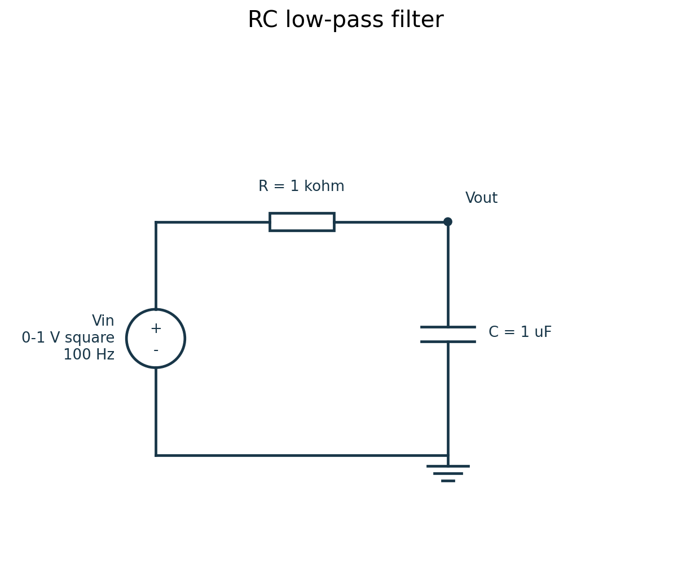
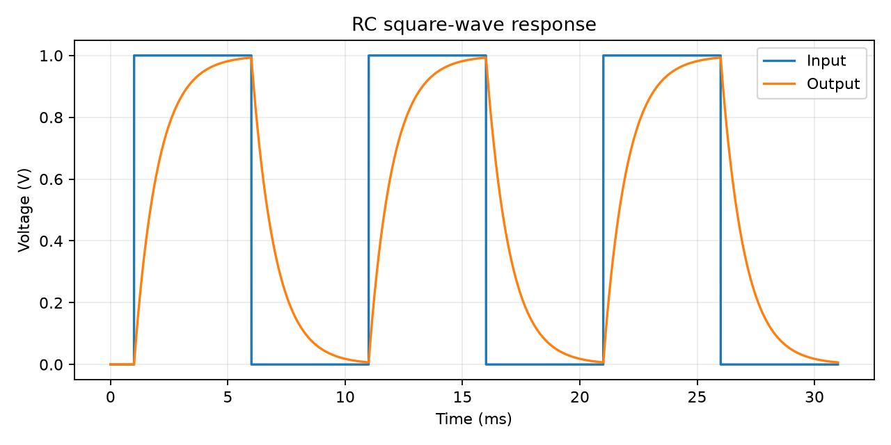
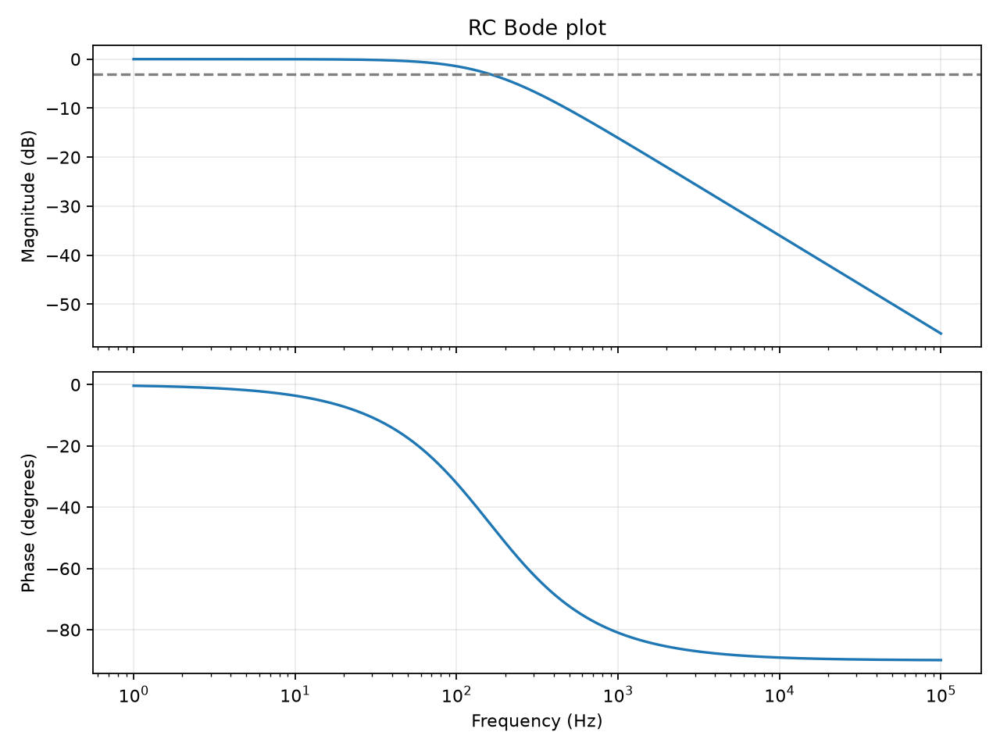
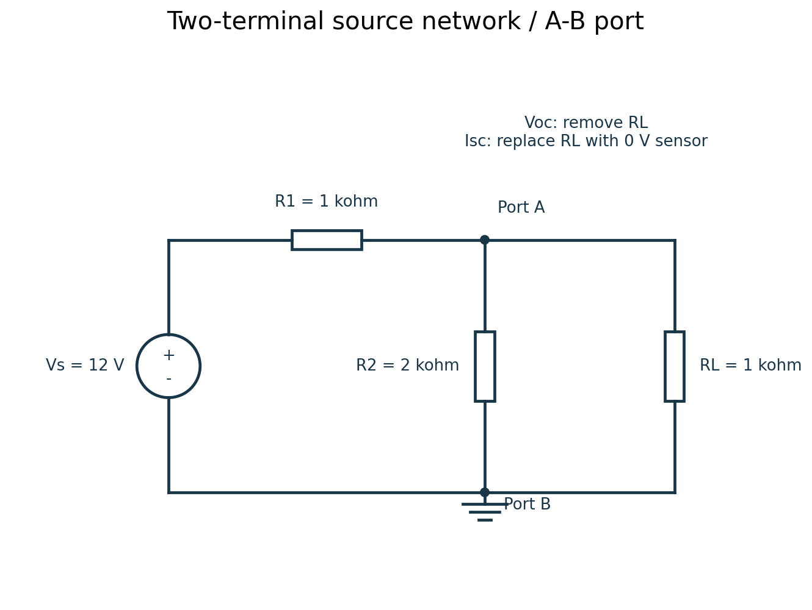
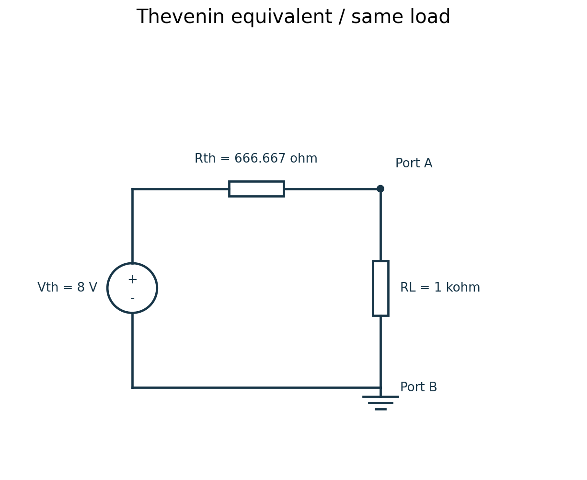
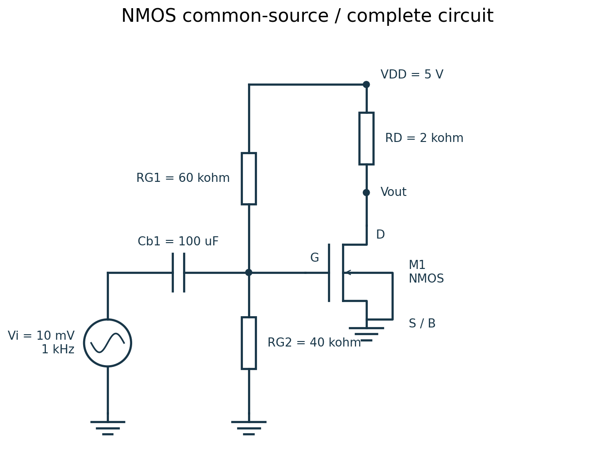
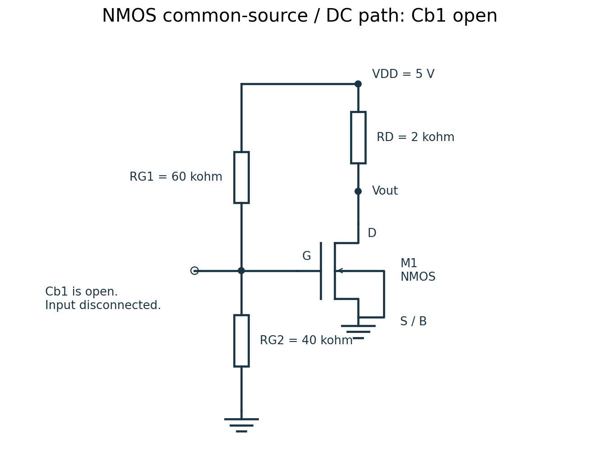
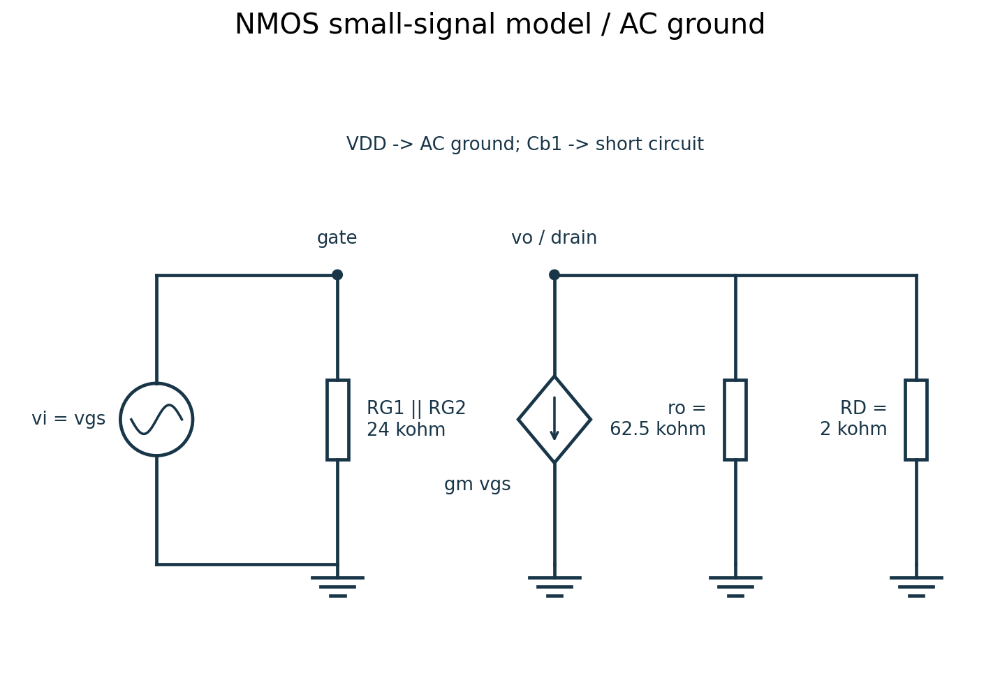
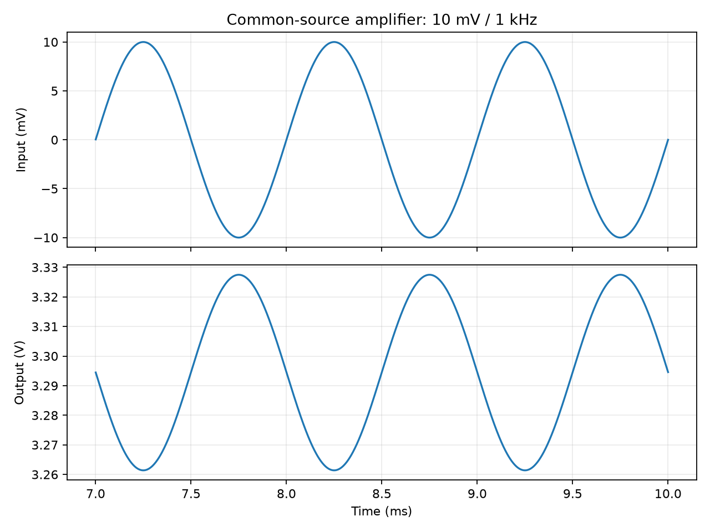

# 大一考核项目：个人主页、轨道贪吃蛇与三个电路实验


## 新增 V2：最短安全路径版

原版 `game/snake.html` 保留不变；新版为 `game/snake_shortest_safe.html`。从主页选择 V1 / V2。新版用 A* 对整条蛇的状态搜索安全约束下的最短进食路径，允许捷径，考虑尾部释放和增长；超预算采用安全推进后重新规划。100 个随机种子均完成 15 次进食，平均 182.88 步，原版为 977.43 步。详细证明、最短性边界与测试见 [V2 算法说明](docs/贪吃蛇V2_算法与验证.md)。两版战绩独立。

## 1. 项目内容与任务书对应

| 任务 | 对应文件 / 完成情况 |
| --- | --- |
| 个人简介 PDF | `profile.pdf`，可用 `profile.json` + `docs/make_profile.py` 修改；真实资料待填写 |
| HTML/CSS 个人主页 | 根目录 `index.html`；GitHub Pages 尚未部署 |
| 小游戏阶段一 | `game/snake.html`：手动控制、进食计分、碰撞失败、填满棋盘通关 |
| 小游戏阶段二 | 同一单文件：AI 自动连续吃 15 个食物，验收后停下显示结果 |
| 新增功能 | 深浅主题、最高分与局数、最近 10 局；支持持久化及重置 |
| Git 至少 3 次提交 | 包含真实的 AI 构建提交历史；作者标注 AI Project Builder。本人修改后仍应提交真实记录 |
| LICENSE | MIT；字体另遵循 `assets/fonts/OFL.txt`，不能将第三方字体当作 MIT |
| 命令行与关键逻辑 | 本 README 第 4、5 节 |
| AI 错误查证与提示词记录 | 本 README 第 6、7 节，区分真实记录与建议提示词 |
| 进阶挑战（三个电路） | `circuits/rc_filter.py`、`thevenin.py`、`mos_amplifier.py`；附图、推导、仿真与对比表 |
| 账号两步验证及提交 | 本人完成；按 `docs/一步步完成与提交.md` 操作 |

网站地址：`file:///C:/Users/31742/Desktop/freshman-project/index.html`（这是格式模板，尚不是已上线地址）。
仓库地址：`https://github.com/Morkis2778/freshman-assessment`。

## 2. 文件与运行方法

| 路径 | 用途 |
| --- | --- |
| `index.html` | 个人网站；所有资源使用相对路径，适合项目型 Pages 网站 |
| `profile.pdf` / `profile.json` | 个人简介成品模板及其可编辑数据 |
| `game/snake.html` | 无框架、无外部资源、可双击打开的游戏 |
| `circuits/*.py` | 三个实验及窄范围兼容辅助模块 |
| `circuits/results/` | 仿真 JSON、原始 CSV、波形 PNG |
| `assets/` | 可编辑 SVG 电路图、PNG 与字体许可证 |
| `docs/` | 分步骤提交说明、PDF 生成器和电路图绘图源代码 |
| `tests/` | 游戏逻辑测试、可选浏览器测试及实际验证结果 |

### 游戏与网页

解压后双击 `index.html`，通过“体验贪吃蛇”进入；也可直接双击 `game/snake.html`。不要仅在 ZIP 预览内打开，以免相对链接找不到文件。手动模式用方向键、WASD、方向按钮或触屏滑动；空格暂停。AI 演示从新局开始，按闭合路线自动行进，吃 15 个食物后停下。选择“快速演示”可减少等待。

### Ubuntu 电路仿真

在项目根目录执行以下命令。Ubuntu 22.04 / 24.04 都可使用这些安装步骤；本次实际验证环境为 Linux、Python 3.12、PySpice 1.5、ngspice 42，不代表已在你的电脑复现。

```bash
sudo apt update
sudo apt install -y python3 python3-venv python3-pip ngspice libngspice0 libngspice0-dev
python3 -m venv .venv
source .venv/bin/activate
python -m pip install -r requirements.txt
python circuits/rc_filter.py
python circuits/thevenin.py
python circuits/mos_amplifier.py
```

正常运行会重新生成 `circuits/results/` 中的图、CSV 和 JSON，并校验主要误差阈值。若找不到 `libngspice.so`，先确认安装 `libngspice0-dev`，不要认为仅 `pip install PySpice` 就已经安装仿真引擎。Windows 用户可直接玩游戏；电路部分建议按上述步骤在 Ubuntu / WSL Ubuntu 运行。

修改 `profile.json` 后执行 `python docs/make_profile.py` 重新生成 PDF；再同步修改 `index.html` 的个人信息。图纸修改可运行 `python docs/draw_schematics.py`。

## 3. 游戏两个阶段：实现与验证

### 阶段一：可手动玩的贪吃蛇

棋盘为 12×12，初始蛇长 3。每步用方向向量更新蛇头；吃到食物时保留蛇尾并加 1 分，未吃到时移除蛇尾。禁止与当前运动方向相反的输入。多个方向键在同一步到来时，都与实际运动方向比较，避免连按两次把蛇直接掉头。

撞墙、撞未离开的身体时失败；不进食时允许进入本步将离开的旧尾格。食物只能生成在空格，且每次从所有空格随机选择；棋盘填满时通关，避免无空格还无限生成食物。游戏显示当前分数、历史最高分、已结束局数与暂停/失败/通关状态。主动开始新局时，未结束的上一局记为“中途结束”。

### 阶段二：AI 自动完成 15 次进食

`cycle` 构造覆盖全部 144 格的闭合路线：沿顶行向右，再在不含最左列的区域逐行往返，最后沿最左列向上回到起点。`cycleIndex` 把坐标映射到路线下标。AI 的下一格始终是 `(i+1)%144`，不会越界。

初始蛇身对应路线第 2、1、0 格。从这一初态开始，蛇头沿路线向前、蛇尾也按相同顺序离开，身体始终是路线上的连续片段；长度小于棋盘格数时，下一格不会是不能离开的身体。食物放在空格，沿路线走至多一圈即可遇到；所以此方法可以保证安全进食，不是通过查看固定食物序列作弊。

这是一种**确定性的规则控制算法**，不是训练神经网络。优点是容易解释且安全；代价是不会抄近路，路径较长。任务书没有要求 AI 使用机器学习。切换 AI 时重新开局，而不是直接接管任意手动蛇形，否则安全证明不成立。

### 新增功能的实现

`localStorage` 保存一个 JSON 对象，包含主题、最高分、累计结束局数和最近 10 局记录；新一局只初始化当前棋盘，不清空这个对象。结束时 `record()` 用 `recorded` 防止重复登记；新记录插在列表前面，用 `slice(0,10)` 截断。主题通过 `body.light` 与 CSS 变量即时切换。重置按钮经确认后清空全部战绩。存储不可用时提示用户，仍可本次游玩。

### 已完成的验证与待复现项

实际执行 `node tests/test_game_logic.cjs`，直接提取并执行交付 HTML 中的原始 JS，结果存于 `tests/game_logic_results.json`。

| 项目 | 实际结果 |
| --- | --- |
| 100 个不同伪随机种子的食物序列 | 100 / 100 完成连续 15 次进食；零碰撞 |
| 单局步数 | 最少 612，最多 1271 |
| 闭合路线 | 144 个格子无重复，相邻含首尾均为曼哈顿距离 1 |
| 手动规则 | 反向输入、暂停、撞墙、撞身、旧尾格、进食增长、填满通关均通过 |
| 自动控制 | 定时器实际注册的回调无需方向输入完成 15 次进食 |
| 数据功能 | 保存主题 JSON、最多 10 条记录、战绩重置通过 |
| 浏览器视觉 / 触屏真实体验 | 当前环境阻止本地 Chromium 启动，未完成浏览器端验收；需本人复现 |

上述 Node 测试使用模拟 DOM / Canvas，能够验证状态逻辑，但不能替代浏览器画面、布局、真实事件及刷新持久化验证。提供 `tests/test_game.py` 可在允许浏览器启动的机器上用 Playwright 检查。该脚本是待本地运行的测试工具，不能将它的存在写成“已通过”。

本人验收步骤：①双击打开并手动吃食物；②撞墙观察失败，再开启新局；③点 AI 自动演示后不操作方向键，等待“验收通过：15”；④切主题并刷新；⑤完成或中途结束多局，确认只列最近 10 局且新局不清空历史；⑥点重置，确认分数、局数、历史清空；⑦缩窄窗口或用手机验证方向按钮和滑动。

## 4. Git、命令行与许可

分支是从某个提交分出的独立开发线，合并是把另一条开发线的改动整合到当前分支。

| 命令 | 用途 |
| --- | --- |
| `cd 目录` | 切换工作目录 |
| `ls` | 查看当前目录内容；`ls -a` 可显示隐藏项 |
| `mkdir 目录` | 创建目录 |
| `git init` | 创建本地仓库；已有 `.git` 时无需重新创建 |
| `git status` | 查看修改、暂存区与当前分支状态 |
| `git add 文件` | 把选定修改放入暂存区 |
| `git commit -m "说明"` | 将暂存修改保存为一个本地版本 |
| `git log --oneline` | 查看简短提交历史 |
| `git switch -c 新分支` | 新建并切换分支 |
| `git merge 分支` | 合并该分支到当前分支 |
| `git remote add origin URL` | 关联远程仓库 |
| `git push -u origin main` | 推送 main 分支并建立跟踪关系 |
| `git pull` | 获取远程提交并整合到本地 |

选择 MIT 是因为项目希望允许他人学习、修改和再分发，同时要求保留版权与许可声明；它也明确不提供担保。个人资料与截图公开前自己核对。不要上传密码、令牌、两步验证二维码或恢复码。字体采用 SIL OFL，随附独立许可证。


## 5. 关键代码讲解草稿（本人需理解并改写）

以下解释由 AI 写，供学习，不冒称本人已掌握。理解后请用自己的表达重写，并填写实际修改过的代码。

第一处是 `step()` 中的碰撞检查。这里先判断下一格是否有食物。如果不进食，本步尾巴会离开，碰撞集合就用 `snake.slice(0,-1)`；若进食，尾巴保留，必须检查完整蛇身。先检查碰撞，再插入新头、决定是否删除旧尾，保证判定和实际更新一致。

第二处是 `cycle` 和 `cycleIndex`。AI 不会每步临时猜方向，而是沿已经证明相邻且闭合的完整路线走。初始身体也按该路线连续摆放，所以身体的顺序不会被破坏，蛇头前方是尚未占用的路线位置；食物生成在空格，沿路线最终能碰到它。任意手动局中途接管可能破坏前提，因此 AI 按钮主动创建新局。

第三处是 `mos_amplifier.py` 的增益测量。脚本在最后五个周期对输入和输出分别拟合“正弦项 + 余弦项 + 直流项”，从两项的平方和开方得到幅度，再求幅度比；相位差接近 180°证实反相。不能用含直流偏置的 `max(vo)/max(vi)` 计算共源增益，也不能把手算值直接写成仿真结果。

本人调整记录：1. 修改个人主页与 PDF 信息。
具体文件：index.html、profile.json、docs/make_profile.py、LICENSE。
修改原因：模板中存在大量[待填写姓名]等占位符，LICENSE未署名。
修改前后：改前为占位符文字；改后替换为本人真实的姓名、专业、邮箱，将底部模板提示文字改为“个人简介”，并在 LICENSE 中补上本人署名。
验证结果：重新运行 python docs/make_profile.py 成功生成了新的 PDF，双击 index.html 确认网页与 PDF 上的信息完全一致。

2. 修复 PDF 生成时的权限报错。
具体文件：终端运行环境（WSL）。
修改原因：在 /mnt/c/ 目录下运行脚本生成 PDF 时，频繁遇到 PermissionError: [Errno 13] Permission denied。
修改前后：发现是因为 Windows 下的 PDF 文件被阅读器占用锁定。改前直接覆盖写入报错；改后关闭了 Windows 端的 PDF 阅读器，确保文件未被占用。
验证结果：重新运行脚本不再报权限错误，成功在项目根目录生成了 profile.pdf。

3. 补充电路仿真环境依赖。
具体文件：WSL Ubuntu 终端环境。
修改原因：运行 circuits/rc_filter.py 等电路脚本时，提示缺少 ngspice 和 Python 相关依赖库。
修改前后：改前环境缺失依赖；改后通过 sudo apt install -y ngspice libngspice0-dev 以及 pip install -r requirements.txt 补全了运行环境。
验证结果：重新激活虚拟环境后运行三个电路脚本，均成功输出 JSON 数据，并在 circuits/results/ 下生成了波形图和 CSV 文件。

## 6. 真实 AI 错误与查证过程

本次 AI 初版 NMOS 代码写了 `sim.save('all','@m1[gm]','@m1[gds]')`，默认这个调用可以保存全部节点与两个器件量。但实际在 PySpice 1.5 中运行报 `TypeError: set expected at most 1 argument, got 3`。检查已安装的 `CircuitSimulation.save` 源码，发现内部是 `set(*args)`；因此这个版本应传入一个列表。随后传列表仍遇到 `KeyError: gate`，继续检查序列化源码发现 `all` 会被从内部集合移除。最终显式保存 `v(gate)`、`v(drain)`、`v(vin)`、`@m1[gm]`、`@m1[gds]`，重新运行后取得正确 OP 与增益。

证据链：AI 初版代码 → 真运行错误 → 查看安装版本源码 → 修改调用 → 重新跑仿真 → 对比独立手算。这个错误不是虚构的“AI 曾经说过”。**查证由 AI 在本环境执行；本人需按代码复现并补充本人记录，才符合“我查证”的要求。**

另一个实际问题是 PySpice 1.5 将 ngspice 42 的 `Using SPARSE 1.3 as Direct Linear Solver` 信息行当作 stderr 错误，导致 `run` 被判失败。`spice_compat.py` 仅忽略这一条完整匹配的求解器提示，真实错误仍进入原错误处理；没有替换或生成仿真数据。ngspice 42 版本提示与器件单位识别提示保留，主要结果再用数值断言检查。

## 7. 提示词与迭代

### 本次真实用户提示词

> 这个是我要完成的几项任务，请依据这个任务书，把完整的项目一步步做出来

本次用户没有逐轮输入更多开发提示词。下面记录 AI 的实际实现迭代，并提供可由本人使用的后续提示词模板；不能把模板冒称成已经发送过的原文。

| 实际迭代 | 想完成什么 | 实际结果 / 调整 |
| --- | --- | --- |
| 1 | 识别全部要求，选定一个小游戏和一个挑战 | 选择贪吃蛇与三个 PySpice 电路；缺失个人信息用明确占位符 |
| 2 | 手动游戏加可靠的 AI | 实现完整规则与闭合路线；测试 100 个随机种子均完成 15 次进食 |
| 3 | 电路手算和仿真一致 | 明确 K 定义；修正 save 调用及 ngspice 提示误判；输出真实 CSV / JSON |
| 4 | 图纸与个人 PDF 可阅读 | 首次图纸标签拥挤、PDF 中文缺字；改用坐标化矢量绘图与嵌入中文字体，重新渲染检查 |
| 5 | 形成可检查交付 | 补上代码解释、实际测试范围、本人必做事项与部署步骤 |


> 请只修改个人主页和 profile.json，将以下真实姓名、专业、兴趣、公开邮箱填入，重新生成 PDF，并检查两个文件的信息完全一致。

> 我已运行贪吃蛇，这是操作步骤和实际结果：1. 打开浏览器双击 index.html 进入游戏；2. 点击“手动新一局”，分别使用方向键与 WASD 键控制蛇的上下左右移动；3. 让蛇连续吃食物，观察分数和身体长度；4. 控制蛇头撞墙，观察失败判定；5. 按下空格键测试暂停与恢复；6. 最后点击“自动新一局”，测试 AI 自动连续吃 15 个食物的功能。

> 我运行 mos_amplifier.py 得到以下输出：```json
{
  "convention": "ID = K * Vov^2 * (1 + lambda * VDS); KP=2K at W/L=1",
  "theory": {
    "VGS_V": 2.0,
    "ID_A": 0.0008527131782945737,
    "VDS_V": 3.2945736434108523,
    "gm_S": 0.0017054263565891472,
    "gds_S": 1.6000000000000003e-05,
    "ro_ohm": 62499.99999999999,
    "Av": -3.3050898383510607
  }
```

## 8. 进阶实验①：RC 低通滤波

参数自选：R=1 kΩ，C=1 μF；输入为 0–1 V、100 Hz 方波。第一次上升在 1 ms，边沿 1 μs。电路由串联电阻和对地电容组成，输出取电容两端。



理论推导：电容电流 `i=C·dvo/dt`，电阻电流 `i=(vi-vo)/R`，联立得到 `RC·dvo/dt+vo=vi`。阶跃从 0 V 到 1 V 时，`vo(t)=1-exp(-t/RC)`。因此 `τ=RC=1000×10⁻⁶=0.001 s=1 ms`。频域 `H(jω)=1/(1+jωRC)`，在幅度为 `1/√2` 时 `ωRC=1`，故 `fc=1/(2πRC)=159.154943 Hz`。

仿真时间常数从第一次上升后的平台段拟合 `ln(1-vo)` 的斜率取得；截止频率从 AC 扫频的 −3.0103 dB 交点插值取得，不直接拿理论公式替代测量。

| 指标 | 手算 | PySpice 实际仿真 | 相对误差 |
| --- | --- | --- | --- |
| τ | 1.000000 ms | 0.999998 ms | 约 0.000208% |
| fc | 159.154943 Hz | 159.152505 Hz | 约 0.001532% |





误差来自有限时间步长、回归区间与频率插值。脚本 `rc_filter.py`；原始数据为 `rc_transient.csv`、`rc_ac.csv`；数值汇总为 `rc.json`。

## 9. 进阶实验②：戴维南定理验证

自选网络：12 V 理想电压源，R1=1 kΩ 从电源接至端口 A，R2=2 kΩ 从 A 接地 B。负载 RL=1 kΩ 接 A–B；测开路电压时移除负载，测短路电流时以 0 V 电压源短接 A–B，并读取该源电流。



开路时，`Voc=12×R2/(R1+R2)=8 V`。将独立电压源置零，理想电压源变短路，所以 `Rth=R1||R2=1000×2000/3000=666.666667 Ω`。端口短路后 R2 两端电压为零，`Isc=12/R1=12 mA`，方向定义为 A 经外部短路流向 B。也可以用 `Voc/Isc=666.666667 Ω` 验证。

负载电压 `VL=Vth×RL/(Rth+RL)=8×1000/1666.666667=4.8 V`，负载电流 `IL=VL/RL=4.8 mA`。脚本分别搭建原网络和等效网络，各自进行 OP 仿真，再比较两者，而不是只调用一遍公式。



| 量 | 手算 | 原网络仿真 | 等效网络仿真 |
| --- | --- | --- | --- |
| Voc | 8.000000 V | 8.000000 V | 不用于此次加载验证 |
| Isc | 12.000000 mA | 12.000000 mA | 不用于此次加载验证 |
| Rth（Voc/Isc） | 666.666667 Ω | 666.666667 Ω | 等效电阻按该值设置 |
| RL 两端电压 | 4.800000 V | 4.800000 V | 4.800000 V |
| RL 电流 | 4.800000 mA | 4.800000 mA | 4.800000 mA |

脚本 `thevenin.py`；结果 `thevenin.json`。此处是线性理想网络，显示精度内相等，不说明任何非线性网络都能用同一个固定戴维南等效替代。

## 10. 进阶实验③：NMOS 共源放大

固定题卡参数：VDD=5 V，RG1=60 kΩ，RG2=40 kΩ，RD=2 kΩ，Vth=1 V，λ=0.02 V⁻¹，输入 10 mV / 1 kHz 正弦。源与体接地，不接额外负载；Cb1 题目认为足够大，仿真用 100 μF，其在 1 kHz 的电抗仅约 1.59 Ω，远小于 24 kΩ 输入偏置电阻。



### K 的约定必须先确定

任务书只给 K=0.8 mA/V²，没有明确电流公式。本报告主结果采用 `ID=K·(VGS−Vth)²·(1+λVDS)`，即 K 已包含 1/2 系数。SPICE Level 1 使用 `ID=(KP/2)·(W/L)·Vov²·(1+λVDS)`，所以取 `W=L=10 μm`、`KP=2K=1.6 mA/V²`、`VTO=1 V`、`LAMBDA=0.02`、`GAMMA=0`、温度与 TNOM 都为 27 ℃。这只明确参数定义，未更改题卡给定物理模型。

如果协会教材将 K 定义为公式前带 1/2 的 β，则应改为 `KP=0.8 mA/V²`。脚本同时输出这一备选定义下的 OP 与理论结果。提交前依据协会教材确认采用哪组。

### 静态工作点



直流下 Cb1 开路，输入信号断开；栅极电流近似为零。分压得 `VGS=VG=5×40/(60+40)=2 V`，过驱动 `Vov=2−1=1 V`。

负载线 `VDS=5−2000·ID`，代入饱和电流方程：

`ID=0.0008×1²×[1+0.02×(5−2000·ID)]`。

整理为 `ID×(1+0.032)=0.00088`，所以 `ID=0.000852713178 A=0.852713178 mA`，`VDS=5−2000×ID=3.294573643 V`。

饱和区要求 `VGS>Vth` 且 `VDS≥VGS−Vth`。这里 `2>1`，`3.294574>1`，假设自洽。输入只有 ±10 mV，工作点附近也保持饱和，不出现削顶。

### 小信号模型与增益



交流下 VDD 为地，Cb1 近似短路；RG1 与 RG2 并联为 24 kΩ。MOS 用从漏极指向源极的 `gm·vgs` 受控电流源和 `ro` 表示，RD 与 ro 均从输出接交流地。

固定 VDS 求偏导：`gm=∂ID/∂VGS=2K·Vov·(1+λVDS)=1.705426357 mS`。

固定 VGS 求偏导：`gds=∂ID/∂VDS=K·Vov²·λ=0.016 mS`，所以 `ro=1/gds=62.5 kΩ`。

无额外负载时 `Av=−gm·(RD||ro)=−gm/(1/RD+gds)=−3.305089838`。

若忽略 λ 造成的输出电导，会得到近似 `−gm·RD≈−3.41085`；本报告保留 ro。常见 `ro≈1/(λID)` 是近似，本题精确值应为 `(1+λVDS)/(λID)`，与偏导法一致。

### OP 与瞬态结果

| 量 | 手算 | PySpice 实际仿真 |
| --- | --- | --- |
| VGS | 2.000000 V | 2.000000 V |
| ID | 0.852713178 mA | 0.852713181 mA |
| VDS | 3.294573643 V | 3.294573637 V |
| gm | 1.705426357 mS | 1.705426356 mS |
| gds | 0.016000 mS | 0.016000 mS |
| Av | −3.305089838 | −3.305073462（瞬态测量） |
| 区域判断 | 饱和 | 饱和 |

瞬态拟合输入幅值约 10 mV，输出幅值约 33.050735 mV，输出直流中心约 3.2946 V；相位差 −179.9963°，证明反相。增益误差约 0.00050%，来源包括耦合电容、有限时间步长和非线性。



| K 为 β、公式前另含 1/2 的备选结果 | 手算 | 仿真 OP |
| --- | --- | --- |
| VGS | 2 V | 2 V |
| ID | 0.433070866 mA | 0.433070870 mA |
| VDS | 4.133858268 V | 4.133858260 V |
| gm | 0.866141732 mS | 此备选只运行 OP，未另测 gm |
| Av | −1.705003410 | 此备选未单独运行瞬态测量 |

脚本 `mos_amplifier.py`；结果 `mos.json`、原始波形 `mos_transient.csv`。仿真图由脚本输出；电路图由 AI 绘图程序生成并核对，**本人须理解连接方式、按要求自己重绘或实际修改后交付**。

## 11. 本人记录

本人复现日期：［2026年10月9日］；系统与版本：［Windows 11 + WSL2 (Ubuntu)；Python 3.14.3；PySpice 1.5；ngspice 45.2］；运行结果：［三个 PySpice 脚本均运行成功，输出无报错。RC 滤波器脚本正确输出了时间常数 tau 和截止频率 fc 的理论值与仿真值（数据高度吻合）；thevenin.py 和 mos_amplifier.py 也正常运行。在 circuits/results/ 目录下成功生成了 rc_transient.png、rc_bode.png、mos_waveform.png 波形图以及对应的 CSV 数据文件。使用 python docs/make_profile.py 成功生成了包含个人信息的 profile.pdf。］。

## 12. 查证来源

- [PySpice 项目与安装说明](https://github.com/PySpice-org/PySpice)
- [PySpice Shared 源码](https://github.com/PySpice-org/PySpice/blob/master/PySpice/Spice/NgSpice/Shared.py)
- [ngspice 用户手册，MOS Level 1 参数](https://ngspice.sourceforge.io/docs/ngspice-manual.pdf)
- [GitHub Pages 发布来源](https://docs.github.com/en/pages/getting-started-with-github-pages/configuring-a-publishing-source-for-your-github-pages-site)
- [GitHub 两步验证配置](https://docs.github.com/en/authentication/securing-your-account-with-two-factor-authentication-2fa/configuring-two-factor-authentication)
- [Noto Sans SC 字体及 OFL](https://github.com/google/fonts/tree/main/ofl/notosanssc)

AI 生成范围：当前代码、图纸、文档和测试均由 AI 生成 / 调整；电路结果来自实际 PySpice + ngspice 运行，游戏验收范围如上。本人调整部分目前为空，待实际完成后填写，不虚构个人工作。
